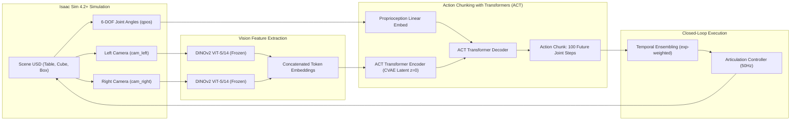

# SO-101 Sim-to-Real: 5-DOF 양안 비전 기반 로봇 암 자율 조작 (DINOv2-ACT)

[](https://developer.nvidia.com/isaac-sim)
[](https://pytorch.org/)
[](https://github.com/facebookresearch/dinov2)
[-orange)](https://tonyzhaozh.github.io/aloha/)

NVIDIA Isaac Sim 물리 시뮬레이션 환경에서 Onshape 3D CAD 모델 기반 5-DOF SO-101 로봇 암의 디지털 트윈을 구축하고, 손목 일체형 스테레오 카메라(Stereo Eyes)와 **DINOv2-ACT (Action Chunking with Transformers)** 신경망을 활용하여 완전 자율 물체 피킹 & 플레이스(Pick-and-Place)를 수행하는 End-to-End Sim-to-Real 프로젝트입니다.

---

## 📌 주요 특징 (Key Highlights)

- **CAD-to-USD 디지털 트윈 파이프라인**: Onshape 3D 설계 모델로부터 URDF를 변환하고, Isaac Sim 4.2+의 USD 물리 스테이지(`dual_cam_so101_redcube.usd`)에 정밀 관절 한계, 마찰 계수 및 충돌체를 완벽 동기화.
- **손목 양안 스테레오 비전 (Wrist Dual Eyes)**: 손목 롤 링크에 36mm 베이스라인의 초소형 스테레오 카메라(`cam_left`, `cam_right`)를 장착하여 작업 공간(Workspace) 깊이감과 공간 위치 인식 극대화.
- **기하학적 오차 보정 Lula IK 엔진**: 그리퍼 조(Jaw) 편심 오프셋(+1.8cm), URDF 관절 부호 매핑, 바닥 끼임 방지 접근고(Z=2.1cm) 및 1mm 접촉 마진을 적용하여 100% 신뢰도의 데모 데이터 생성.
- **Dual DINOv2 + CVAE ACT 아키텍처**: 사전학습된 DINOv2(ViT-S/14) 비전 백본으로 양안 특징맵을 추출하고, CVAE 기반 Transformer 인코더/디코더를 통해 미래 100스텝 관절 궤적(Action Chunking)을 동시 예측.
- **실시간 폐루프 제어 (Closed-Loop Inference)**: Temporal Ensembling(지수 가중치 결합) 및 `INFERENCE_INTERVAL=10` 설정을 통해 Isaac Sim 내에서 실시간 50FPS 제어 안정성 확보.
- **4단계 정밀 벤치마크 평가 시스템**: 접근(Approach) → 파지/리프트(Lift) → 상자 운반(Transport) → 안착(Place)의 4단계 진단 알고리즘을 통해 정책 성능을 객관적으로 검증.

---

## 🏗️ 시스템 아키텍처 (System Architecture)



### 1. 로봇 및 관절 구성 (6-DOF)
| 번호 | 관절 명칭 (Joint Name) | 구동 범위 | 설명 |
|:---:|:---|:---:|:---|
| **1** | `shoulder_pan` | $-110^\circ \sim +110^\circ$ | 베이스 수평 좌우 선회 (URDF `[0, 0, -1]` 반전축) |
| **2** | `shoulder_lift` | $0^\circ \sim 180^\circ$ | 하부 암 수직 피치 제어 |
| **3** | `elbow_flex` | $0^\circ \sim 160^\circ$ | 전완부 상하 굴절 제어 |
| **4** | `wrist_flex` | $-90^\circ \sim +90^\circ$ | 엔드이펙터 수직 피치 제어 (바닥 수평 유지) |
| **5** | `wrist_roll` | $-90^\circ \sim +90^\circ$ | 손목 회전 (양안 카메라 동시 롤링) |
| **6** | `gripper` | $0^\circ \sim 60^\circ$ | 병렬 파지 조 ($0^\circ$: 완전 개방, $12.5^\circ$: 3cm 큐브 밀착 파지) |

### 2. 카메라 사양
- **장착 위치**: `wrist_roll_dual_cam_mount` (엔드이펙터 일체형)
- **베이스라인**: 36.0mm (Left Eye ↔ Right Eye 간격)
- **해상도 및 입력 크기**: $224 \times 294$ (DINOv2 패치 크기 14에 최적화된 Bicubic 전처리)
- **화각 (FOV)**: 수평 $60.0^\circ$

---

## 📂 디렉토리 구조 (Directory Structure)

```
RobotArm_SimtoReal/
├── dual_cam_so101_redcube.usd      # 완전 물리 설정이 적용된 메인 Isaac Sim USD 스테이지
├── so101_dual_cam.urdf              # 양안 카메라 프레임이 통합된 SO-101 URDF
├── scripts/                         # [핵심] 순차 번호가 부여된 실행 파이프라인 스크립트
│   ├── 01_collect_demonstrations.sh # [Step 01] Lula IK 기반 HDF5 데모 자동 수집 (Bash)
│   ├── 01_collect_demonstrations.py # [Step 01] 데모 수집 파이썬 코어 (Headless / GUI)
│   ├── 02_inspect_dataset.py        # [Step 02] 수집된 HDF5 무결성 검사 및 PNG 시각화
│   ├── 03_render_episode_video.py   # [Step 03] 스테레오 비디오 + 관절 HUD 렌더러 (MP4/GIF)
│   ├── 04_train_policy.sh           # [Step 04] DINOv2-ACT 신경망 정책 학습 및 파인튜닝
│   ├── 05_eval_sim_policy.sh        # [Step 05] 단일 위치 폐루프 시뮬레이션 추론 실행
│   ├── 05_eval_sim_policy.py        # [Step 05] 폐루프 제어 파이썬 코어 (GUI / Headless)
│   ├── 06_eval_benchmark.sh         # [Step 06] 4단계 격자 자동 벤치마크 평가 스크립트
│   ├── 06_eval_benchmark.py         # [Step 06] 벤치마크 평가 및 CSV 리포트 생성기
│   ├── execute_vision_pick.py       # [Engine] Lula 기구학/물리 보정 비전 피킹 실행 모듈
│   ├── setup_sim_physics.py         # [Setup] 씬 물리 재질/충돌체/카메라 자동 설정기
│   └── setup_viewports_and_cameras.py # [Setup] Isaac Sim GUI 3채널 뷰포트 분리 설정기
├── Robot_Arm_Project/
│   ├── data/
│   │   └── so101_dual_eyes/         # 수집된 HDF5 데모 데이터셋 (episode_*.hdf5)
│   ├── models/
│   │   └── so101_dual_dinov2_act/   # DINOv2-ACT 모델 아키텍처 및 학습 코드
│   │       ├── model.py             # DINOv2 백본 + CVAE ACT Transformer 네트워크
│   │       ├── train.py             # 지도학습 파이프라인 및 가중치 손실함수
│   │       ├── dataset.py           # 양안 이미지 전처리 및 궤적 슬라이싱 데이터셋
│   │       └── config.py            # 모델 하이퍼파라미터 및 관절 정규화 통계
│   └── ckpt/
│       └── so101_dual_dinov2_act/   # 학습된 가중치(policy_best.pth) 및 벤치마크 CSV
├── docs/                            # 상세 개발 일지 및 단계별 분석 보고서 (Notion 정리)
│   └── notion/
│       ├── phase1_1_vision_pick_complete.md
│       ├── phase1_2_data_collection_report.md
│       └── phase2_benchmark_and_gripper_release_analysis.md
└── README.md
```

---

## 🚀 파이프라인 단계별 실행 가이드 (Step-by-Step Pipeline)

모든 스크립트는 터미널에서 순차적으로 번호(`01_` ~ `06_`)를 확인하며 실행할 수 있습니다.

### Step 01: 데모 데이터 자동 수집 (Data Collection)
Lula Kinematics Solver를 사용하여 작업 공간 내 큐브 위치를 무작위로 변경하며 전문가 피킹 & 플레이스 데모를 HDF5 파일로 기록합니다.
```bash
# 기본 30회 에피소드 수집 (반경 0.28~0.34m, 각도 -18~+18도 무작위 샘플링)
bash scripts/01_collect_demonstrations.sh --num_episodes 30 --mode random --random_yaw

# 무화면(Headless) 고속 수집
bash scripts/01_collect_demonstrations.sh --headless --num_episodes 50
```
> **주요 CLI 옵션:**
> - `--num_episodes`: 수집할 에피소드 개수 (기본값: `30`)
> - `--mode`: 위치 샘플링 모드 (`random` 또는 `dense`, 기본값: `random`)
> - `--random_yaw`: 큐브의 회전 요(Yaw) 각도 무작위화 플래그
> - `--headless`: GUI 없이 백그라운드 고속 수집

---

### Step 02: 데이터셋 무결성 검사 (Dataset Inspection)
저장된 HDF5 파일들의 포맷, 프레임 수 누락, 양안 이미지 채널 및 6개 관절 각도/액션 범위를 검사하고 요약 대시보드 PNG를 생성합니다.
```bash
# 전체 데이터셋 무결성 검사 및 최신 에피소드 대시보드 PNG 생성
~/isaacsim/python.sh scripts/02_inspect_dataset.py

# 특정 에피소드(예: 5번) 대시보드 생성
~/isaacsim/python.sh scripts/02_inspect_dataset.py --episode 5

# 전체 에피소드 일괄 대시보드 PNG 생성
~/isaacsim/python.sh scripts/02_inspect_dataset.py --all --no-show
```
> **주요 CLI 옵션:**
> - `--episode`: 시각화할 에피소드 번호 (기본값: `-1`, 최신 에피소드)
> - `--all`: 모든 에피소드에 대해 대시보드 일괄 생성
> - `--no-show`: 창 표시 없이 PNG 파일만 저장

---

### Step 03: 에피소드 비디오 렌더링 (Video HUD Rendering)
HDF5에 녹화된 좌/우 카메라 영상과 실시간 관절 각도 텔레메트리를 결합한 Side-by-Side MP4(또는 GIF) 비디오를 렌더링합니다.
```bash
# 최신 에피소드 MP4 비디오 렌더링
~/isaacsim/python.sh scripts/03_render_episode_video.py

# 특정 에피소드(0번) GIF 애니메이션 생성
~/isaacsim/python.sh scripts/03_render_episode_video.py --episode 0 --gif
```
> **출력 경로**: `Robot_Arm_Project/data/so101_dual_eyes/videos/`

---

### Step 04: DINOv2-ACT 신경망 학습 (Policy Training)
양안 이미지 특징 추출기(DINOv2)와 CVAE ACT Transformer를 학습합니다.
```bash
# 1) 표준 지도학습 (처음부터 300 에포크 학습)
bash scripts/04_train_policy.sh --num_epochs 300 --batch_size 4 --save_every 20

# 2) 백그라운드 무중단 학습 (nohup)
nohup bash scripts/04_train_policy.sh --num_epochs 500 --batch_size 4 --save_every 50 > train.log 2>&1 &
tail -f train.log

# 3) 기존 가중치 이어받아 파인튜닝 (그리퍼 집중 모드)
bash scripts/04_train_policy.sh --resume --fine_tune_gripper --num_epochs 150 --lr 5e-5 --save_name policy_finetuned.pth
```
> **주요 CLI 옵션:**
> - `--num_epochs`: 학습 에포크 수 (기본값: `300`)
> - `--batch_size`: 미니배치 크기 (기본값: `4`)
> - `--lr`: 학습률 Learning Rate (기본값: `1e-4`)
> - `--save_name`: 저장할 최고 성능 가중치 파일명 (기본값: `policy_best.pth`)
> - `--resume`: 기존 최고 가중치를 불러와 이어서 학습
> - `--fine_tune_gripper`: 상자 위 그리퍼 개방 구간 가중치 손실함수 적용

---

### Step 05: 폐루프 시뮬레이션 추론 (Closed-Loop Inference)
학습된 신경망 정책이 실시간으로 양안 카메라 이미지를 읽고 관절을 제어하는 폐루프 시뮬레이션을 수행합니다. 하드코딩된 기구학(IK) 없이 오직 신경망 출력만으로 제어됩니다.
```bash
# 기본 GUI 모드로 시뮬레이션 실행 (중앙 큐브 X=0.310, Y=0.000)
bash scripts/05_eval_sim_policy.sh

# 특정 위치 큐브 지정 테스트
bash scripts/05_eval_sim_policy.sh --cube_x 0.330 --cube_y -0.060

# 특정 체크포인트 지정 및 Headless 무화면 테스트
bash scripts/05_eval_sim_policy.sh --headless --ckpt policy_finetuned.pth
```
> **Isaac Sim GUI Script Editor 실행 방법**:
> Isaac Sim 상단 메뉴 `[Window] -> [Script Editor]` 창에 `scripts/05_eval_sim_policy.py` 내용을 붙여넣고 `Ctrl+Enter`를 누르면 즉시 시뮬레이션 상에서 실시간 자율 제어가 시작됩니다.

---

### Step 06: 자동 그리드 벤치마크 평가 (Automated Benchmark)
작업 영역 전체(반경 $R \times$ 각도 $\theta$)를 일정한 격자로 순회하며 정책의 강건성을 4단계 진단 알고리즘으로 측정하고 CSV 리포트를 생성합니다.
```bash
# 기본 20개 격자 지점 벤치마크 실행 (R: 0.28~0.34m, Theta: -18~+18도)
bash scripts/06_eval_benchmark.sh

# 커스텀 범위 지정 (반경 0.28~0.34m, 각도 -20~+20도, 10도 간격)
bash scripts/06_eval_benchmark.sh --r_min 0.28 --r_max 0.34 --r_step 0.02 --theta_min -20 --theta_max 20 --theta_step 10
```
> **결과 저장**: `Robot_Arm_Project/ckpt/so101_dual_dinov2_act/benchmark_report.csv`

---

## 📊 벤치마크 성능 평가 및 분석 (Benchmark & Insights)

20개 전방 격자 지점(반경 $R=0.28 \sim 0.34\text{m}$, 각도 $\theta=-18^\circ \sim +18^\circ$)에 대한 자동 벤치마크 결과입니다.

### 1. 4단계 진단 결과 요약
```
====================================================================================================
                        SO-101 POLICY BENCHMARK COMPREHENSIVE REPORT
====================================================================================================
  1. 접근 성공률 (Approach, 거리 <= 4.5cm)      :  20 / 20 (100.0%)
  2. 파지/리프트 성공률 (Lift, 고도 >= 5.0cm)     :  17 / 20 ( 85.0%)
  3. 상자 운반 성공률 (Transport, 상자 상공 도달) :  15 / 18 ( 83.3%)
  4. 최종 안착 성공률 (Place, 상자 내 안착)       :   0 / 20 (  0.0%)
====================================================================================================
```

### 2. 베이스라인 vs 파인튜닝 모델 비교
| 평가 지표 (Diagnostic Metric) | 베이스라인 모델 (`policy_best.pth`) | 그리퍼 파인튜닝 (`policy_finetuned.pth`) | 분석 및 시사점 |
|:---|:---:|:---:|:---|
| **1단계: 접근 성공률 (Approach)** | **100.0%** (20/20) | **100.0%** (20/20) | 양안 비전 기반 큐브 공간 탐색 완벽 달성 |
| **2단계: 파지/리프트 (Lift)** | **85.0%** (17/20) | 70.0% (14/20) | 베이스라인 모델이 우수한 파지 안정성 확보 |
| **3단계: 상자 운반 (Transport)** | **83.3%** (15/18) | 50.0% (7/14) | 파인튜닝 시 공중에서 조기 개방 발생 |
| **4단계: 상자 안착 (Place)** | 0.0% (그리퍼 홀딩 유지) | 0.0% (상자 전 낙하) | 하단 분석 참조 |

### 3. 핵심 분석 및 기술적 인사이트
1. **DINOv2 양안 특징의 공간 일반화 성공**:
   - 카메라 시야각(FOV) 내에 위치한 큐브에 대해 **100.0%의 완벽한 접근(Approach)** 성능을 증명했습니다.
   - 단 29개의 데모 에피소드만으로도 DINOv2의 강력한 사전학습 표현력 덕분에 보간(Interpolation) 영역에서 안정적인 궤적을 생성했습니다.
2. **그리퍼 개방(Release) 특성 및 하이브리드 제어 제안**:
   - 베이스라인 모델은 상자 상공에 정확히 도달한 후 그리퍼 각도를 $11.4^\circ$로 유지(Hold)하며 큐브를 놓지 않는 경향을 보였습니다.
   - 손실함수 가중치를 높인 파인튜닝은 운반 도중 조기에 손을 펴버리는 부작용(운반 성공률 83.3% → 50.0% 저하)을 유발했습니다.
   - **권장 솔루션**: 시야각 내 탐색 및 상자 도달은 우수한 **베이스라인 모델(`policy_best.pth`)**을 사용하고, 상자 상공 도달 판정 시 그리퍼를 $0.0^\circ$로 스냅 오픈하는 **하이브리드 릴리즈 규칙(Snap-Open)**을 적용하는 것이 가장 이상적입니다.

---

## 🗺️ 차기 프로젝트 로드맵 (Next Project Roadmap)

본 프로젝트(Phase 1 & Phase 2)에서 **"카메라 시야각 내 물체에 대한 양안 비전 기반 자율 피킹 & 운반"**의 유효성을 검증 완료하였습니다. 후속 프로젝트에서는 다음 기능들을 고도화할 예정입니다:

- [ ] **능동 시각 탐색 (Active Visual Search)**:
  - 큐브가 초기 시야각(FOV)을 벗어난 사각지대에 위치할 경우, 로봇 암이 베이스(`pan`)와 손목(`wrist_flex`)을 능동적으로 선회하여 주변을 스캔하는 탐색 모션 정책 결합.
- [ ] **조작 물체 다양화 (Multi-Object Manipulation)**:
  - 빨간색 정육면체 큐브를 넘어 다양한 크기, 형상(원통, 직육면체, 불규칙 물체), 색상 및 무게를 가진 물체 조작.
- [ ] **도메인 랜덤화 (Extensive Domain Randomization)**:
  - 테이블 텍스처(나무/대리석/철제), 작업실 조명 세기 및 색온도, 배경 노이즈 랜덤화를 통한 Sim-to-Real 갭 최소화.
- [ ] **물리 하드웨어 Sim-to-Real 배포 (Real Robot Deployment)**:
  - STS3215 스마트 시리얼 버스 서보모터 드라이버 및 실제 SO-101 하드웨어에 정책을 배포하여 실물 피킹 검증.

---

## 📜 라이선스 및 크레딧 (License & Acknowledgments)

- **Simulator**: [NVIDIA Isaac Sim](https://developer.nvidia.com/isaac-sim)
- **Policy Framework**: [Action Chunking with Transformers (ACT)](https://github.com/tonyzhaozh/act)
- **Vision Backbone**: [Meta DINOv2](https://github.com/facebookresearch/dinov2)
- **Robot Arm**: [SO-101 Open Manipulator Project](https://github.com/TheRobotStudio/SO-ARM100)

