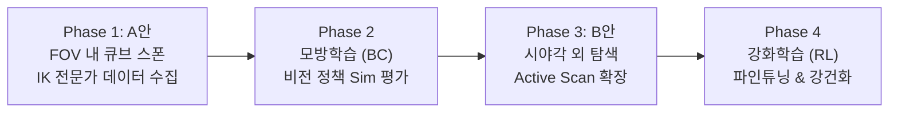
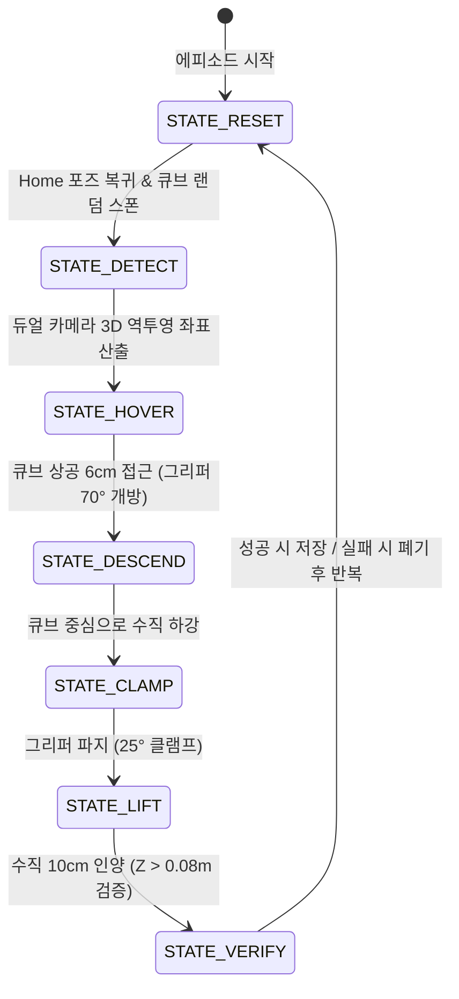

# SO-101 비전 기반 자율 파지(Grasp) 파이프라인 개발 로드맵

> **문서 목적**: 외부의 치트키(시뮬레이터 절대 좌표) 없이 손목 듀얼 카메라와 관절 각도만으로 임의의 큐브를 인식하고 파지하는 **End-to-End Visuomotor Policy**의 개발 표준 가이드라인. 작업 중 방향성 일탈을 방지하고 각 Phase의 완료 기준을 정의합니다.

---

## 1. 프로젝트 개요 및 핵심 원칙

### 1.1 최종 목표
* **비전-동작 통합 정책 (Visuomotor Policy)**:
  * 입력: 손목 듀얼 카메라 RGB 영상 + 관절 위치(Proprioception)
  * 출력: 6개 관절 목표 각도 (5개 암 모터 + 1개 그리퍼)
  * 제약 조건: 글로벌 절대 좌표(`/World/RedCube`의 Transform)를 정책 입력으로 일절 사용하지 않음.

### 1.2 4단계 점진적 개발 전략


---

## 2. 시스템 아키텍처 및 데이터 규격

### 2.1 관측 및 액션 공간 (Observation & Action Space)

| 구분 | 항목 | 차원 (Shape) | 단위 / 범위 | 설명 |
| :--- | :--- | :---: | :---: | :--- |
| **Observation** | `image_left` | `(128, 128, 3)` | uint8 [0, 255] | 손목 좌측 카메라 RGB 영상 |
| | `image_right` | `(128, 128, 3)` | uint8 [0, 255] | 손목 우측 카메라 RGB 영상 |
| | `joint_positions` | `(5,)` | float32 (rad) | 1~5번 모터 현재 관절 각도 |
| | `gripper_position` | `(1,)` | float32 (rad) | 그리퍼 핑거 현재 위치 |
| **Action** | `target_joints` | `(5,)` | float32 (rad) | 다음 스텝 1~5번 모터 목표 각도 |
| | `target_gripper` | `(1,)` | float32 (rad) | 다음 스텝 그리퍼 목표 각도 |

* **제어 주기**: $30\text{ Hz}$ ($\Delta t = 0.033\text{ s}$)

---

## 3. 단계별 상세 계획

### Phase 1: IK 기반 전문가 데이터 자동 수집기 (A안 우선 진행)

#### 3.1 큐브 생성 영역 (카메라 초기 FOV 내)
* **X축 (전방)**: $0.18\text{ m} \sim 0.28\text{ m}$
* **Y축 (좌우)**: $-0.10\text{ m} \sim +0.10\text{ m}$
* **Z축 (높이)**: $0.015\text{ m}$ (책상 상판 $z=0.0\text{ m}$ 위 안착)

#### 3.2 유한 상태 머신 (FSM: Finite State Machine)



#### 3.3 데이터셋 저장 구조 (HDF5 또는 `.npz`)
* 수집 목표: 성공 에피소드 **100 ~ 200개** (에피소드당 약 90~150 스텝)
* 저장 파일 포맷:
  ```text
  dataset/
    ├── episode_0000.npz  # left_img, right_img, q, q_vel, action
    ├── episode_0001.npz
    └── metadata.json      # 통계(평균, 표준편차), 성공률, 스폰 범위
  ```

---

### Phase 2: 모방학습(Behavior Cloning) 모델 훈련 & 검증

#### 4.1 네트워크 아키텍처 (Visuomotor Policy)
* **비전 인코더**: 경량 사전학습 ResNet-18 (또는 MobileNetV3) 백본
  * 좌/우 영상 각각 처리 후 128차원 임베딩 결합 ($128 \times 2 = 256\text{ 차원}$)
* **상태 인코더**: 관절 각도 6차원 -> MLP 64차원 임베딩
* **융합 헤드 (Fusion Head)**:
  * 비전(256) + 관절(64) = 320차원 -> 3계층 MLP (`[256, 128, 6]`)
  * 출력: 다음 스텝 목표 관절 각도 (6차원)

#### 4.2 검증 기준
* Isaac Sim 씬에서 **IK 플래너를 끄고**, 오직 신경망 추론만으로 임의 위치의 큐브를 집어 올리는 성공률 **80% 이상** 달성.

---

### Phase 3: B안 확장 (Active Scan: 시야각 외 탐색)

* **문제 정의**: 큐브가 카메라 정면 시야각 밖($|Y| > 0.15\text{ m}$)에 스폰된 경우.
* **해결책**:
  * 초기 상태에서 큐브 검출 실패 시 `STATE_SEARCH`로 진입.
  * 손목 1번 모터(Pan)를 좌우(±35°)로 부드럽게 스캔(Sine Sweep).
  * 큐브가 시야에 포착되는 즉시 스캔을 멈추고 Phase 1의 FSM 피킹으로 전환.
* 이 탐색 궤적 데이터까지 데이터셋에 추가하여, **"안 보이면 두리번거리다 찾아서 집는 정책"**으로 업그레이드.

---

### Phase 4: 강화학습(RL with Demonstrations) 파인튜닝

* **목적**: 큐브를 살짝 빗맞추거나 미끄러졌을 때, 모방학습의 한계(Distributional Shift)를 극복하고 스스로 재시도하도록 훈련.
* **알고리즘**: SACfD (Soft Actor-Critic with Demonstrations) 또는 PPO + BC Loss.
* **보상 함수 (Reward Function)**:
  $$R = R_{\text{reach}} + R_{\text{align}} + R_{\text{grasp}} + R_{\text{lift}} - R_{\text{action\_smooth}}$$

---

## 4. 일탈 방지 원칙 (Core Rules)

> [!IMPORTANT]
> 1. **치트키 금지**: 학습 및 추론 단계에서 `/World/RedCube`의 3D 월드 좌표를 정책의 입력으로 주어서는 안 됩니다. (오직 카메라 영상 + 관절 엔코더만 사용)
> 2. **모터 5번 고정 유지**: 그리퍼가 카메라 사이 중앙을 바라보도록 5번 모터(`wrist_roll`)의 중립(0°)을 유지하여 카메라 왜곡을 방지합니다.
> 3. **검증 없는 다음 단계 진행 금지**: Phase 1의 데이터 수집이 완전히 검증(재생 시 에러 0, 성공 궤적 100건 이상 확보)되기 전에는 모델 학습 코드로 넘어가지 않습니다.

---

## 5. 즉시 착수할 다음 작업 (Next Step)

* **작업**: **Phase 1-1: 큐브 랜덤 스폰 및 4단계 FSM 자동 피킹 스크립트 작성**
* **결과물**: Script Editor에서 실행 시 큐브가 랜덤 위치에 생성되고, 로봇이 카메라로 이를 감지해 자동으로 집어 올리는 전 과정 시연.
