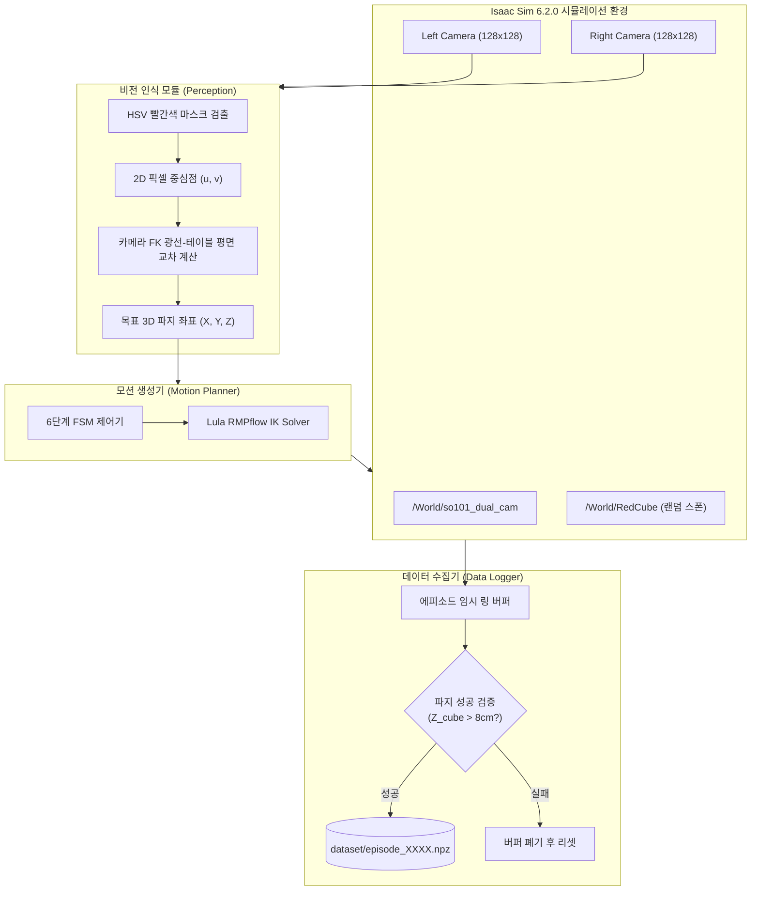

# Phase 1-1: 큐브 랜덤 스폰 및 FSM 기반 IK 자동 피킹 & 데이터 수집 상세 구현 계획

> **문서 상태**: 준비 완료 (승인 대기)  
> **상위 문서**: [01_so101_vision_policy_pipeline.md](file:///home/jw/Documents/PersonalProjects/RobotArm_SimtoReal/docs/01_so101_vision_policy_pipeline.md)  
> **목적**: Phase 1의 핵심인 **"시야각(FOV) 내 큐브 랜덤 생성 $\rightarrow$ 비전 인식 $\rightarrow$ IK 궤적 생성 $\rightarrow$ 자동 집기 $\rightarrow$ 고품질 모방학습 데이터셋 저장"** 파이프라인의 모듈별 상세 사양 및 구현 단계 정의.

---

## 1. Phase 1-1 전체 아키텍처



---

## 2. 모듈별 상세 설계 사양

### 2.1 비전 인식 모듈 (Vision Perception)
* **원칙**: 큐브의 시뮬레이터 내부 절대 좌표(`/World/RedCube` Transform)를 치트키로 읽지 않고, 카메라 영상 분석과 로봇 기구학(Forward Kinematics)만을 사용합니다.
* **검출 알고리즘**:
  1. 좌측 카메라 RGB 영상 획득 (`128x128x3`).
  2. OpenCV 기반 HSV 색상 임계치 필터링:
     * Red Hue 범위: $[0, 10] \cup [170, 180]$, Saturation: $[120, 255]$, Value: $[70, 255]$
  3. 최대 컨투어(Contour)의 모멘트 계산으로 큐브 2D 중심 픽셀 $(u_c, v_c)$ 도출.
  4. **광선-평면 역투영 (Ray-Plane Intersection)**:
     * 카메라 내부 파라미터(Intrinsic Matrix $K$)를 통해 정규화 카메라 좌표계 광선 방향 벡터 $d_c$ 계산:
       $$d_c = K^{-1} \begin{bmatrix} u_c \\ v_c \\ 1 \end{bmatrix}$$
     * 손목 링크(또는 카메라 프레임)의 FK 월드 포즈 $(R_{wc}, T_{wc})$를 적용하여 월드 광선 벡터 $d_w = R_{wc} \cdot d_c$ 계산.
     * 테이블 상판($Z_{world} = 0.015\text{ m}$, 큐브 중심 높이) 평면과의 교차점 산출:
       $$t = \frac{Z_{\text{target}} - T_{wc, z}}{d_{w, z}}, \quad P_{\text{target}} = T_{wc} + t \cdot d_w$$
     * 결과: 큐브의 3D 목표 파지 위치 $(X_{\text{target}}, Y_{\text{target}}, Z_{\text{target}})$ 획득.

---

### 2.2 6단계 유한 상태 머신 (FSM Controller)

각 에피소드는 아래 6개 상태를 순차적으로 전이하며 완전 자동으로 진행됩니다.

| 상태 (State) | 지속 조건 / 시간 | 동작 내용 | 비고 |
| :--- | :--- | :--- | :--- |
| **`STATE_RESET`** | 약 1.0초 (30 스텝) | 로봇을 Home 포즈로 이동, 그리퍼 완전 개방(70°), `/World/RedCube`를 $X \in [0.18, 0.28]\text{ m}, Y \in [-0.10, 0.10]\text{ m}$ 범위 내 무작위 스폰 | 물리적 안정화 대기 |
| **`STATE_DETECT`** | 1~5 스텝 | 듀얼 카메라 영상 캡처 후 3D 목표 좌표 $P_{\text{target}}$ 계산 | 검출 실패 시 리셋 |
| **`STATE_HOVER`** | 약 1.5초 (45 스텝) | 큐브 상공 6cm ($Z + 0.06\text{ m}$) 지점으로 RMPflow 궤적 생성 및 부드러운 접근 | 그리퍼 개방 상태 유지 |
| **`STATE_DESCEND`** | 약 1.0초 (30 스텝) | 큐브 높이 ($Z + 0.005\text{ m}$)까지 수직 하강 | 그리퍼 중심 맞춤 |
| **`STATE_CLAMP`** | 약 0.8초 (25 스텝) | 그리퍼 핑거를 닫아 큐브 파지 ($q_6 \rightarrow 0.25\text{ rad}$) | 접촉력 확보 |
| **`STATE_LIFT`** | 약 1.2초 (35 스텝) | 파지 상태를 유지한 채 수직 10cm ($Z + 0.10\text{ m}$) 인양 | 인양 완료 |
| **`STATE_VERIFY`** | 1 스텝 | 큐브의 최종 높이 확인 ($Z_{\text{cube}} > 0.08\text{ m}$) | 성공 시 저장 / 실패 시 폐기 |

---

### 2.3 데이터셋 포맷 및 버퍼 구조 (`.npz`)

수집되는 각 에피소드는 신경망 학습(PyTorch Dataset/DataLoader)에 즉시 입력 가능한 형태로 압축 저장됩니다.

* **저장 경로**: `<workspace>/dataset/episode_{0000~0199}.npz`
* **에피소드당 배열 사양** (총 길이 $T \approx 120 \sim 150$ 스텝):
  ```python
  {
      "left_rgb": np.ndarray,      # (T, 128, 128, 3), dtype=uint8
      "right_rgb": np.ndarray,     # (T, 128, 128, 3), dtype=uint8
      "joint_positions": np.ndarray, # (T, 6), dtype=float32 (1~5번 암 + 6번 그리퍼)
      "joint_velocities": np.ndarray,# (T, 6), dtype=float32
      "actions": np.ndarray,       # (T, 6), dtype=float32 (다음 스텝 목표 관절 각도)
      "state_id": np.ndarray,      # (T,), dtype=int32 (FSM 상태 코드 0~5)
      "cube_pos_gt": np.ndarray    # (T, 3), dtype=float32 (디버깅/검증용 GT 좌표)
  }
  ```
* **메타데이터 파일** (`dataset/metadata.json`):
  * 총 에피소드 수, 총 프레임 수
  * 관절 각도/액션의 최소값, 최대값, 평균, 표준편차 (학습 시 정규화용)
  * 수집 성공률 (Success Rate: 예, 94.5%)

---

## 3. 구현 단계별 로드맵 (Step-by-Step Implementation)

### Step 1: 비전 파이프라인 단독 검증 스크립트 (`test_vision_detection.py`)
* **목표**: 큐브가 임의 위치에 있을 때 좌/우 카메라 영상에서 빨간색을 감지하고, 역투영 계산된 3D 좌표와 실제 큐브 월드 좌표 간의 오차가 **3mm 이내**인지 검증.
* **확인 사항**:
  * 렌즈 왜곡 유무 및 Intrinsic 행렬 정확도.
  * Extrinsic 변환 행렬(Optical Frame $\rightarrow$ World Frame) 일치 여부.

### Step 2: RMPflow 고정 자세 피킹 모션 스크립트 (`test_rmpflow_pick.py`)
* **목표**: 정해진 3D 목표 좌표로 RMPflow가 부드럽게 접근, 하강, 파지, 인양하는지 단일 에피소드 단위로 검증.
* **확인 사항**:
  * 5번 모터(`wrist_roll`)가 0°를 견고하게 유지하는지 확인.
  * 그리퍼 핑거가 큐브와 충돌하여 튕겨나가지 않고 안정적으로 물리는지 확인.

### Step 3: FSM 기반 무인 자동 수집 메인 스크립트 (`collect_demonstrations.py`)
* **목표**: 루프를 돌며 100~200개의 에피소드를 완전 자동으로 수집.
* **안전 및 예외 처리**:
  * 큐브가 테이블 밖으로 튕겨 나갔을 경우 타임아웃 감지 후 강제 리셋.
  * 파지 실패(인양 후 큐브 높이가 8cm 미만) 시 해당 에피소드 자동 폐기.
  * 콘솔에 실시간 진행 상황 표시: `[Episode 23/100] SUCCESS (Steps: 134, Grasp Err: 1.8mm)`.

### Step 4: 데이터셋 무결성 검증 뷰어 (`inspect_dataset.py`)
* **목표**: 수집된 `.npz` 파일을 로드하여 좌/우 카메라 영상이 프레임마다 정상 저장되었는지, 관절 궤적이 튀지 않고 매끄러운지 영상 및 그래프로 확인.

---

## 4. 핵심 체크리스트 및 성공 판정 기준

| 검증 항목 | 합격 기준 | 확인 방법 |
| :--- | :--- | :--- |
| **비전 좌표 오차** | 3D 유클리드 거리 $< 3.5\text{ mm}$ | 계산된 좌표 vs Ground-Truth 비교 |
| **FSM 자동 파지 성공률** | $90\%$ 이상 (100회 시도 중 90회 이상 성공) | `collect_demonstrations.py` 자동 통계 |
| **데이터 누락/결측치** | `NaN` 또는 빈 프레임 0건 | `inspect_dataset.py` 자동 검사 |
| **제어 주기 일관성** | $30\text{ Hz} \pm 2\text{ Hz}$ 유지 | 타임스탬프 델타 검사 |
| **치트키 배제** | 정책 학습에 쓰일 Feature에 GT 좌표 미포함 | `.npz` 키 분리 및 검증 |

---

## 5. 다음 작업 안내

본 상세 계획이 승인되면 **Step 1 (비전 파이프라인 단독 검증)** 및 **Step 2 (RMPflow 파지 모션 결합)**을 하나로 엮어, Isaac Sim Script Editor에서 바로 실행하여 눈으로 확인할 수 있는 **프로토타입 피킹 스크립트**를 작성하겠습니다.

