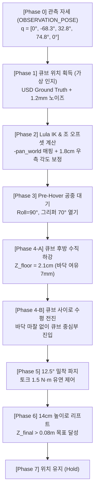

# [SO-101 Sim-to-Real] Phase 1-1: 기구학 & 물리 튜닝 기반 피크 앤 리프트(Pick & Lift) 보고서

> **작성일:** 2026-11-10  
> **프로젝트:** SO-101 5-DOF 로봇 암 Sim-to-Real 조작 정책 개발 베이스라인  
> **환경:** NVIDIA Isaac Sim 6.2.0 | Ubuntu 24.04 LTS | RTX 5070 | Python 3.11  
> **상태:** 기구학 및 물리 파라미터 튜닝 완료 (12.5° 밀착 파지 및 14cm 리프트 동작 확인)

---

## 1. 개요 및 인지 방식 명확화

본 보고서는 SO-101 5자유도 로봇 암의 모방학습 데이터 수집 및 정책 학습을 위해, **시뮬레이션 내 물리 환경을 안정화하고 기구학(IK) 모션 제어를 튜닝한 과정**을 정리한 문서입니다.

> ⚠️ **현재 타깃 큐브 위치 획득 방식 안내:**  
> 현재 단계(Phase 1-1)는 실제 카메라 영상을 직접 분석하는 비전 인식 모델이 적용된 것이 아닙니다.  
> 시뮬레이션 환경 내 **USD 스테이지의 정답 좌표(Ground Truth)를 읽어온 뒤 1.2mm 합성 노이즈를 더해 사용하는 "가상 인지"** 방식을 사용하고 있습니다.  
> 실제 손목 카메라 영상(RGB)으로부터 로봇 관절을 직접 제어하는 비전 정책은 다음 단계인 **Phase 1-2(데이터 수집) 및 Phase 2(모델 학습)**에서 구현됩니다.

### 🎯 Phase 1-1에서 튜닝한 주요 내용
1. **패드 밀착 파지 달성:** 그리퍼 조(Jaw)와 큐브 사이의 공중 부양 틈을 줄여, 양쪽 패드가 큐브 표면에 직접 닿는 **12.5° 파지** 설정
2. **접촉 반발력 및 튕김 완화:** 큐브 질량(45g) 부여, 관입 탈출 속도 제한, 감쇠(Damping) 설정을 통해 큐브가 튕겨 나가지 않고 조 안으로 들어오도록 물리 환경 조정
3. **그리퍼 닫힘 시 팔 솟구침 완화:** 모터 토크 제한(`maxForce = 1.5 N·m`)을 적용하여 큐브 접촉 시 충격을 흡수하도록 유연 제어 적용
4. **베이스 회전축 및 비대칭 조 오프셋 보정:**
   - URDF `[0, 0, -1]` 관절축 반전에 맞게 음(-) 부호 정합
   - 한쪽만 움직이는 모터 구조로 인한 1.8cm 횡방향 오프셋을 회전 각도($\Delta\text{pan}$)로 보정
5. **바닥 긁힘 방지:** 손목 $-1.0^\circ$ 미세 틸트 및 $Z_{\text{floor}} = 2.1\text{cm}$ 접근 궤적으로 지면 마찰 및 하우징 걸림 방지

---

## 2. 시스템 제어 흐름

---

## 3. 주요 트러블슈팅 및 해결 과정

### 📌 1단계: 베이스 Pan 관절축 반전 & IK 방향 불일치
* **문제 증상:** 큐브 위치를 바꿀 때마다 로봇 암이 큐브 반대 방향을 바라보며 전진함.
* **원인:** SO-101 URDF에서 `shoulder_pan` 회전축이 `[0, 0, -1]`로 정의되어 있어, 월드 각도와 관절 제어 방향이 반대였음.
* **해결:**
  - 웜스타트 각도를 `-pan_world`로 매핑.
  - Lula IK가 계산한 베이스 관절값 `solved_pan = float(q_grasp[0])`을 모든 경유점(Pre-Hover, Pre-Grasp, Grasp, Lift)에 동일하게 동기화.

### 📌 2단계: 비대칭 턱(Jaw) 구조로 인한 큐브 밀림
* **문제 증상:** 전진 시 큐브가 그리퍼 사이로 들어오지 못하고, 고정 턱 바깥쪽에 부딪혀 밀려남.
* **원인:** 모터 1개로 한쪽 턱만 움직이는 구조상, 70° 열었을 때 양 턱의 중심선이 로봇 축 기준 우측으로 약 1.8cm 치우침.
* **해결:**
  - 횡방향 오프셋 1.8cm를 고려해 접근 방향을 우측으로 약간 틀어 진입($\Delta\text{pan} = \arctan2(0.018, R_{\text{cube}})$).
  - 큐브가 열려 있는 두 턱의 정중앙 사이로 유입되도록 경로 수정.

### 📌 3단계: 바닥 긁힘 및 손목 하우징 걸림
* **문제 증상:** 전진할 때 그리퍼 아래쪽 손목 하우징이 바닥 테이블을 긁어 마찰이 발생함.
* **원인:** 목표 고도가 낮고, 손목 각도가 아래로 숙여져 있었음.
* **해결:**
  - 진입 높이를 $Z_{\text{floor}} = 0.021\text{m}$ (2.1cm)로 설정.
  - `wrist_flex` 관절을 위로 1.0° 살짝 들어주어, 턱 끝 높이를 유지하면서 뒤쪽 손목 하우징이 바닥과 6~8mm 여유를 갖도록 조정.

### 📌 4단계: 접촉 시 큐브 튕김 및 팔 솟구침 현상
* **문제 증상:**
  1. 그리퍼가 큐브에 닿을 때 큐브가 심하게 떨리며 튕겨나감.
  2. 그리퍼가 닫히면서 로봇 팔 전체가 위로 튕겨 올라감.
* **원인:**
  1. 큐브에 질량 및 감쇠 설정이 없어 PhysX의 관입 반발력이 과도하게 작용함.
  2. 그리퍼 모터가 강체 위치 제어(`maxForce = 50 N·m`)로 설정되어, 큐브를 누르는 힘의 반작용이 로봇 팔 관절을 밀어 올림.
* **해결:**
  - **큐브 물성치 설정:** 실제 3cm 블록 질량(45g) 반영, 최대 관입 탈출 속도를 0.4 m/s로 제한, Damping(선형 2.0, 각 1.5)을 주어 큐브가 부드럽게 밀려 들어오도록 설정.
  - **그리퍼 모터 토크 제한:** `stiffness = 40.0`, `damping = 10.0`, `maxForce = 1.5 N·m`로 낮추어 큐브에 닿았을 때 무리하게 누르지 않고 부드럽게 감싸 쥐도록 제어.

### 📌 5단계: 그리퍼가 닿지 않은 채 큐브가 들리는 현상 (공중 부양 파지)
* **문제 증상:** 큐브를 들어 올리긴 하지만, 화면상으로 그리퍼 패드가 큐브에 닿지 않고 허공에 뜬 상태로 잡힘.
* **원인:**
  1. 그리퍼 닫힘 목표 각도(초기 28°)가 3cm 큐브 폭에 비해 너무 넓었음.
  2. 조 메쉬 충돌체가 단일 볼록 껍질(`convexHull`)로 설정되어 안쪽 오목한 공간이 메워져 있었고, PhysX 기본 접촉 마진(2cm)으로 인해 보이지 않는 충돌 볼륨이 먼저 큐브를 쥐어버림.
* **해결:**
  - 조 충돌체에 접촉 마진 1mm(`contactOffset = 0.001m`, `restOffset = 0.0m`)를 부여하고, 복합 볼록 분해(`convexDecomposition`)를 적용하여 턱 모양에 맞춤.
  - 파지 목표 각도를 **12.5°**로 수정하여 그리퍼 패드가 큐브 양면에 직접 닿아 잡히도록 설정.

---

## 4. 최종 파라미터 일람표

| 항목 | 파라미터명 | 설정값 | 목적 및 내용 |
| :--- | :--- | :--- | :--- |
| **파지 각도** | `TARGET_GRIP_DEG` | **12.5°** | 3.0cm 큐브 양면에 그리퍼 패드 밀착 |
| **개방 각도** | `OPEN_GRIP_DEG` | **70.0°** | 큐브 접근 시 진입 공간 확보 |
| **바닥 고도** | `z_floor` | **0.021 m** (2.1cm) | 지면 긁힘 방지 (하우징 7mm 여유) |
| **손목 보정** | `wrist_flex offset` | **-1.0°** | 손목 하우징 지면 간섭 방지 |
| **조 오프셋** | `d_jaw_offset` | **+0.018 m** (+1.8cm) | 한쪽 구동 턱 편향 보정 (중앙 진입) |
| **접촉 마진** | `contactOffset` | **0.001 m** (1mm) | 공중 부양 파지 방지 및 메쉬 형태 일치 |
| **그리퍼 토크** | `gripper maxForce` | **1.5 N·m** | 접촉 충격 완화 및 팔 솟구침 방지 |
| **그리퍼 강성** | `gripper stiffness` | **40.0** (Damp=10.0) | 유연 파지(토크 제한 순응) |
| **큐브 질량** | `cube mass` | **0.045 kg** (45g) | 현실적인 물체 관성 반영 |
| **탈출 속도** | `maxDepenVelocity` | **0.4 m/s** | 충돌 시 튕김 완화 |

---

## 5. 모듈형 스크립트 안내

### 🛠️ 1) 물리 환경 설정 및 저장: `scripts/setup_sim_physics.py`
새로운 씬에서 로봇이나 물체를 새로 배치했을 때, 한 번의 실행으로 물리 마진과 재질을 설정하고 USD 파일에 영구 저장합니다.
* **내용:** 마찰 재질, 큐브 질량/감쇠/탈출속도, 그리퍼 모터 토크 제한, 1mm 접촉 마진 및 볼록 분해 적용 후 `stage.Save()`
* **실행:**
  - Isaac Sim **Script Editor**에서 실행
  - 또는 터미널: `~/isaacsim/python.sh scripts/setup_sim_physics.py [USD파일경로]`

### 🚀 2) 파지 동작 실행: `scripts/execute_vision_pick.py`
12.5° 파지 로직이 적용된 독립 실행 스크립트입니다.
* **내용:** 관측 자세 $\rightarrow$ 큐브 위치 확인 $\rightarrow$ IK 계산 $\rightarrow$ 하강 및 전진 $\rightarrow$ 12.5° 파지 $\rightarrow$ 14cm 리프트 $\rightarrow$ 위치 유지
* **실행:** Isaac Sim **Script Editor**에서 실행 (Ctrl+Enter)

---

## 6. 향후 계획 (Next Steps)

* **Phase 1-2: 모방학습 데이터셋 수집**
  - 본 스크립트의 동작 궤적을 활용하여 여러 위치의 큐브에 대한 관측-행동 쌍(카메라 이미지 + 관절 각도) 자동 수집.
* **Phase 2: 비전 정책 학습**
  - 손목 듀얼 카메라 RGB 영상으로부터 직접 관절 각도를 추론하는 정책(ACT / Diffusion Policy) 학습 진행.
