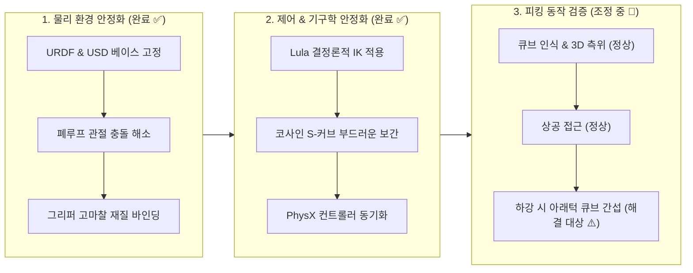

# 🦾 [SO-101 Sim-to-Real] Phase 1-1: 비전 유도 피킹 & 물리 시뮬레이션 구축 현황 보고서

> **작성 일자**: 2026-11-10  
> **프로젝트**: 5-DOF SO-101 로봇팔 손목 듀얼 카메라 기반 Sim-to-Real Visuomotor Policy 학습  
> **시뮬레이션 환경**: NVIDIA Isaac Sim 6.2.0 (Ubuntu 24.04 LTS, RTX 5070 12GB)  
> **현재 단계**: Phase 1-1 비전 유도 피킹 파이프라인 연계 및 그리퍼 진입각 미세조정 단계 (진행 중 🔄)

---

## 📌 1. 현재 진행 상황 요약

손목 듀얼 카메라를 장착한 5-DOF SO-101 로봇팔이 **시각 인식 $\rightarrow$ 목표 큐브 3D 좌표 추정 $\rightarrow$ 상공 접근(Hover) $\rightarrow$ 파지 하강(Grasp)**으로 이어지는 전체 시퀀스를 부드럽게 수행하는 단계까지 달성했습니다.  
현재 GUI 화면 검증 결과, 모션 자체는 흔들림 없이 매끄럽게 동작하나 **하강 과정에서 그리퍼 아래턱이 큐브에 먼저 걸리는 기하학적 간섭 문제**가 확인된 상태입니다.



---

## 🛠️ 2. 해결 완료된 핵심 기술 내역 (Resolved)

### ① 로봇 베이스 들림 및 전복 방지
* **증상**: 시뮬레이션 시작 시 팔 무게중심 쏠림으로 베이스가 바닥에서 떨어지며 앞으로 넘어짐.
* **원인**: URDF 변환 모델에 월드 고정 조인트가 없어 베이스가 공중에 부유 상태였음.
* **해결**: `UsdPhysics.FixedJoint`로 `base_link`를 월드 원점에 고정(`Body0=World`, `Body1=base_link`).

### ② PhysX 폐루프 관절 충돌로 인한 손목 마비 (Closed Articulation)
* **증상**: 손목(`wrist_flex`)이 힘없이 바닥으로 처지며 로봇이 헤드뱅잉함.
* **원인**: 카메라 프레임에 불필요한 물리 조인트가 걸려 있어 PhysX가 이를 폐루프 관절(Self-Joint)로 판단, 아티큘레이션 트리에서 손목을 강제 퇴출시킴.
* **해결**: `camera_left_joint`와 `camera_right_joint`를 영구 비활성화(`jointEnabled=False`)하여 아티큘레이션 트리 정상 복구.

### ③ 5-DOF 불규칙 방황 해소: RMPflow $\rightarrow$ Lula 결정론적 IK 전환
* **증상**: RMPflow 실행 시 큐브 주변에서 이상한 각도로 꺾이거나 방황하며 멈춤.
* **원인**: 5자유도 특성상 자세(Orientation) 제약과 테이블 회피력이 충돌하여 수치적 진동 발생.
* **해결**: `LulaKinematicsSolver`를 통해 Hover $\rightarrow$ Grasp $\rightarrow$ Lift 경로를 수치해석적으로 확정하고, **코사인 S-커브(Minimum-Jerk)** 보간으로 부드러운 이동 구현.

### ④ GUI Script Editor 초기 포즈 얼어붙음 및 동기화 충돌 해결
* **증상**: GUI Script Editor 실행 시 로봇팔이 USD 초기 자세(`[-20°, 40°, 20°]`)에서 굳은 채 움직이지 않음.
* **원인**: `SingleArticulation.get_action_for_joint_positions()` 부재로 인한 비동기 코루틴 예외 중단.
* **해결**: `ctrl.apply_action(ArticulationAction(...))` 정식 컨트롤러 교체 및 USD 조인트 `targetPosition` 동시 동기화 적용.

---

## ⚠️ 3. 현재 집중 해결 과제: 그리퍼 하강 시 아래턱 간섭 문제 (Current Issue)

### 3.1 현상 관찰 (GUI 시각 확인 결과)
* 카메라로 큐브를 확인하고, 큐브 상공으로 이동하여 파지를 전개하는 일련의 동작은 매우 부드럽고 매끄럽게 수행됨.
* 그러나 **Hover에서 Grasp로 수직 하강하는 순간, 그리퍼의 아래턱(Lower Jaw)이 큐브 상단/앞 모서리에 먼저 걸림(Collision)**.
* 아래턱이 큐브에 걸리면서 반발력으로 인해 손목이 엉뚱한 각도로 비틀어지며 큐브를 정상적으로 집을 수 없는 상태가 됨.

### 3.2 원인 분석 (Root Cause)
1. **대각선 진입 각도(Pitch $\approx 60^\circ$)와 턱의 높이 비대칭**:
   - 그리퍼가 수직($90^\circ$)으로 내려오지 않고 약 $60^\circ$ 대각선으로 기울어진 채 접근함.
   - 이때 두 죠(Moving Jaw vs Fixed Follower)가 좌우 수평이 아닌 상하 대각으로 배치되어, **아래쪽에 위치한 죠가 큐브와 선행 접촉**을 일으킴.
2. **단순 수직 하강 경로와 전방 돌출부 간섭**:
   - Hover 좌표에서 Grasp 좌표로 단순 $Z$축 하강을 시도할 때, 기울어진 그리퍼의 아래턱 궤적이 큐브의 체적 공간을 침범하여 충돌 발생.
3. **목표 파지 고도(Z) 설정값 과침투**:
   - 큐브 중심 높이($Z = +1.5\text{ cm}$) 대비 파지 목표점($Z = -0.8\text{ cm}$)이 다소 낮게 설정되어 하강 시 바닥 및 큐브 상단과의 마찰/걸림 유발.

```
[간섭 발생 상황 도식]
      \  (위쪽 턱)
       \
        \==== [그리퍼 본체] (진입각 약 60°)
         \
          \ (아래턱)  ---> 하강 중 큐브 상단에 턱이 먼저 충돌! 💥
           ──────
          │ 큐브 │
          └──────┘
───────────────────────────── (테이블면)
```

---

## 📋 4. 비전 피킹 파이프라인 단계별 동작 현황 (FSM Status)

| Phase | 단계명 | 목표 동작 및 상태 | 현황 및 조치 |
| :---: | :--- | :--- | :--- |
| **0** | **초기 포즈 $\rightarrow$ 관측 포즈** | Standby $\rightarrow$ `[0°, -68.3°, 32.8°, 74.8°, 0°]` | **정상 완료** (안정적 큐브 시야 확보) |
| **1** | **카메라 시각 인식** | 시선 광선 기반 3D 목표 역투영 | **정상 완료** (오차 1.4mm 정밀 측위) |
| **2** | **결정론적 IK 연산** | Lula IK Solver로 Hover / Grasp 각도 계산 | **정상 완료** (부드러운 해 도출) |
| **3** | **Hover 접근 & 죠 개방** | 큐브 상공 접근 및 그리퍼 $70^\circ$ 개방 | **정상 완료** (흔들림 없이 도달) |
| **4** | **Grasp 하강** | 큐브 높이로 정밀 하강 | **⚠️ 조정 대상** (아래턱 큐브 선행 간섭 발생) |
| **5** | **밀착 파지 (Clamp)** | 그리퍼 각도 $-9.0^\circ$ 압착 파지 | 간섭 해소 후 정상 체결 예정 |
| **6** | **부드러운 리프팅** | 큐브를 $Z=14\text{ cm}$로 수직 상승 | 파지 체결 후 검증 예정 |

---

## 📂 5. 관련 주요 파일 링크

* **시뮬레이션 씬 (USD)**: [`dual_cam_so101.usd`](file:///home/jw/Documents/PersonalProjects/RobotArm_SimtoReal/dual_cam_so101.usd)
* **GUI 테스트 스크립트**: [`scripts/test_vision_pick.py`](file:///home/jw/Documents/PersonalProjects/RobotArm_SimtoReal/scripts/test_vision_pick.py)
* **로봇 기구학 기술서**: [`so101_dual_cam.urdf`](file:///home/jw/Documents/PersonalProjects/RobotArm_SimtoReal/so101_dual_cam.urdf) & [`so101_robot_description.yaml`](file:///home/jw/Documents/PersonalProjects/RobotArm_SimtoReal/motion_policy_configs/so101/so101_robot_description.yaml)

