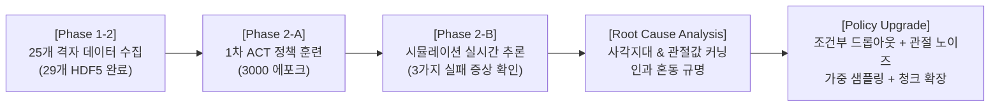

# [SO-101 Sim-to-Real] Phase 1-2 & Phase 2: 양안 DINOv2-ACT 정책 개발 및 비전 기반 추론 트러블슈팅 보고서

> **작성일:** 2026-11-11  
> **프로젝트:** SO-101 5-DOF 로봇 암 Sim-to-Real 조작 정책 개발 베이스라인  
> **환경:** NVIDIA Isaac Sim 6.2.0 | Ubuntu 24.04 LTS | RTX 5070 | Python 3.11 | PyTorch 2.11+cu128  
> **현재 상태:** 29개 에피소드 고밀도 데이터셋 수집 완료 | 1차 추론 실패 원인 분석 완료 | 인과 혼동 방지 비전 강화 학습 파이프라인(가중 샘플링, 관절 노이즈/조건부 드롭아웃) 구축 완료

---

## 1. 개요 및 진행 현황 요약

본 문서는 **Phase 1-2(양안 카메라 데이터셋 수집)**부터 **Phase 2(DINOv2-ACT 모방학습 정책 훈련 및 시뮬레이션 추론 검증)**까지 진행된 전체 개발 과정과, 1차 추론 테스트에서 발견된 문제점 분석 및 이를 해결하기 위한 정책 고도화 내역을 정리한 보고서입니다.



---

## 2. Phase 1-2: 양안(Dual-Eyes) 데모 데이터 수집

* **카메라 구성:** 손목 좌/우 스테레오 카메라 (`cam_left`, `cam_right`), $640 \times 320$ RGB, 50Hz
* **수집 방식:** Standalone Headless 모드 자동화 (`scripts/collect_demonstrations.py`)
* **샘플링 공간 (25개 균등 격자점):**
  * 반경 거리 $R \in [0.28, 0.295, 0.31, 0.325, 0.34]\text{ m}$ (5단계)
  * 회전 각도 $\theta \in [-20^\circ, -10^\circ, 0^\circ, +10^\circ, +20^\circ]$ (5단계)
* **수집 결과:** 총 **29개 유효 에피소드** 확보 (`episode_0000.hdf5` ~ `episode_0028.hdf5`, 각 665스텝)
* **검증 도구 개발:**
  * `scripts/inspect_dataset.py`: 8개 주요 시점별 양안 카메라 및 관절 궤적 대시보드 시각화
  * `scripts/render_episode_video.py`: 좌/우 카메라 사이드바이사이드 동영상(MP4/GIF) 및 관절 HUD 렌더러

---

## 3. 1차 시뮬레이션 추론 결과 및 실패 증상 분석

1차 훈련 모델(`policy_best.pth`, 3,000 에포크)을 Isaac Sim 실시간 폐루프 제어(`scripts/eval_sim_policy.py`)에 연결하여 테스트한 결과, **3가지 비정상 동작**이 관찰되었습니다:

1. **숙이면서 큐브가 시야에서 벗어나면 그 자리에 멈춤 (Stall / Freeze)**
2. **큐브가 그리퍼 사이에 안 들어왔는데도 허공에서 그리퍼를 닫고 상자로 이동함**
3. **출발 시점($t=0$)부터 큐브 위치와 무관하게 엉뚱한 방향(평균 궤적)으로 출발함**

---

## 4. 근본 원인 분석 (Root Cause Analysis)

상세 궤적과 카메라 뷰 분석 결과, 위 3가지 문제는 **기구학 경로의 사각지대**와 **ACT 모방학습의 전형적인 인과 혼동(Causal Confusion / 관절값 커닝)**이 복합되어 발생한 것으로 규명되었습니다.

### 원인 ①: IK 접근 경로의 심각한 시각 사각지대 ($t = 20 \sim 85$, 약 1.3초간 큐브 소실)
* 로봇이 $t=0$ 관측 자세에서 하강할 때, 팔이 큐브 쪽으로 가기도 전에 **손목(`wrist_flex`)이 $+74.8^\circ \rightarrow -81^\circ$로 155°나 급격하게 꺾임**.
* 이로 인해 $t=20 \sim 85$ 구간 동안 양안 카메라가 로봇 앞 빈 바닥만 비추게 되어 **큐브가 시야에서 완전히 사라짐**.
* 카메라에 빈 바닥만 보이는 상태에서 미세한 추론 오차가 누적되어 관절값(`qpos`)이 데모 범위를 벗어나면(OOD), 모델이 갈 길을 잃고 멈추게 됨.

### 원인 ②: 관절 상태 커닝 (Proprioceptive Shortcut) & 초기 샘플링 결핍
* 665스텝 중 로봇이 **순수하게 카메라만 보고 큐브 위치를 판단해야 하는 구간은 $t = 0 \sim 10$ (전체의 1.5%)**뿐임.
* 나머지 98.5%($t > 15$) 구간은 이미 팔이 꺾여있어 **카메라를 안 보고 현재 관절값(`qpos`)만 봐도 29개 궤적 중 어디인지 100% 식별 가능**.
* 기존 데이터로더는 에포크당 1스텝만 무작위 추출하여, 3,000 에포크 동안 **출발 시점($t=0\sim10$)을 학습한 횟수가 에피소드당 평균 45번에 불과**.
* **결과:** 모델이 복잡한 비전 특징을 버리고 **"관절값 흐름 외우기"**로 최적화됨.
  * 출발 시점($t=0$)에는 관절값이 모든 에피소드에서 똑같아 커닝이 안 통하므로 **엉뚱한 평균 방향으로 출발**.
  * 일단 내려간 뒤에는 큐브 유무와 상관없이 **관절값이 파지 각도에 도달하면 무조건 그리퍼를 닫고 상자로 향함**.

### 원인 ③: 제어 주기(50Hz) 대비 짧은 청크 크기 (`CHUNK_SIZE = 50`) 및 이미지 비율 왜곡
* 50Hz 기준 `CHUNK_SIZE = 50`은 **단 1.0초** 분량으로, 사각지대 구간(1.3초)보다 짧아 $t=0$에서 본 큐브 정보가 도착 전에 소진됨.
* 카메라 원본 $640 \times 320$ (2:1 비율)이 $224 \times 294$ (3:4 비율)로 압축되면서 가로 방향 좌우 각도 분해능이 왜곡됨.

---

## 5. 정책 고도화 및 해결 구현 내역

문제를 근본적으로 해결하기 위해 다음 **4가지 핵심 메커니즘**을 구현 및 검증 완료하였습니다.

### 1) 가중 타임스텝 샘플링 (Weighted Sampling)
* 단순 무작위 샘플링 대신, 핵심 구간에 높은 가중치를 부여하는 확률 분포 적용:
  * **초기 탐색 구간 ($t = 0 \sim 40$): 가중치 5.0배** $\rightarrow$ 출발 시 비전 학습 빈도 5배 이상 급증
  * **파지 직전 구간 ($t = 120 \sim 240$): 가중치 3.0배** $\rightarrow$ 허공 파지 방지
* `steps_per_episode = 50`을 적용하여 1 에포크당 샘플 수를 29개에서 **1,450개**로 대폭 확장.

### 2) 관절값 가우시안 노이즈 주입 (Gaussian Noise)
* 모델 입력 `qpos`에 **$\sigma = 0.02\text{ rad}$ ($\approx 1.15^\circ$)** 노이즈를 섞어 관절값 소수점 암기를 방지하고 폐루프 복구 능력 부여. (정답 레이블 `action`과 미세 제어가 필요한 그리퍼 관절은 노이즈 제외)

### 3) 큐브 시야 기반 조건부 관절 드롭아웃 (Conditional Proprioceptive Dropout)
* **핵심 혁신:** 큐브가 없는 사각지대 구간($t=20\sim90$)에서 관절값마저 가리면 '눈 감고 손발 마비된 상태'가 되므로, **사각지대는 드롭아웃에서 제외**.
* **큐브가 시야에 확실히 들어오는 구간($t < 20$, $t \ge 90$)에서만 20% 확률로 `qpos` 입력을 0으로 마스킹**.
* **효과:** 로봇이 출발할 때와 집을 때는 관절값을 신뢰할 수 없게 만들어, **100% 카메라 속 붉은 큐브 위치와 그리퍼 상대 거리에 의존**하도록 강제.

### 4) 모델 및 VRAM 최적화
* **`CHUNK_SIZE = 100`:** 한 번의 추론으로 50Hz 기준 2.0초 앞까지 예측하도록 확장.
* **`IMAGE_SIZE = (182, 364)`:** 원본 $640 \times 320$의 **2:1 가로세로 비율**을 왜곡 없이 100% 보존하며, DINOv2 패치(14) 배수($14\times13$, $14\times26$)로 맞춰 Isaac Sim 구동 중에도 12GB VRAM 안정성 확보.

---

## 6. 재학습 실행 방법 및 검증 파이프라인

### 🚀 학습 실행 (프로젝트 루트 기준)
```bash
# 백그라운드 무중단 실행 (권장: 300 에포크)
nohup bash scripts/train_policy.sh --num_epochs 300 --batch_size 4 --save_every 20 > train_output.log 2>&1 &

# 실시간 학습 진행 확인
tail -f train_output.log
```
> 💡 **참고:** 1 에포크당 1,450개 시점을 학습하므로 300 에포크는 기존 3,000 에포크 대비 약 5배 이상의 고밀도 학습량($435,000$ iterations)에 해당합니다.

### 📊 검증 및 평가 순서
1. **오프라인 궤적 검증 (MAE 오차 확인):**
   ```bash
   bash scripts/train_policy.sh models/so101_dual_dinov2_act/eval_playback.py --episode 0
   ```
2. **시뮬레이션 실시간 추론 (Pick-and-Place 검증):**
   ```bash
   ~/isaacsim/python.sh scripts/eval_sim_policy.py
   ```

