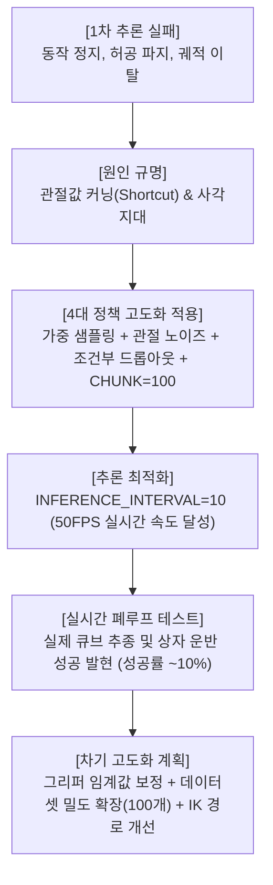
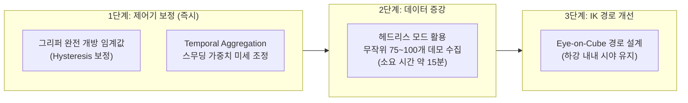

# [SO-101 Sim-to-Real] Phase 2: DINOv2-ACT 비전 정책 고도화 및 실시간 추론 검증 보고서

> **작성일:** 2026-11-11  
> **프로젝트:** SO-101 5-DOF 로봇 암 Sim-to-Real 조작 정책 개발 베이스라인  
> **환경:** NVIDIA Isaac Sim 6.2.0 | Ubuntu 24.04 LTS | RTX 5070 | Python 3.11 | PyTorch 2.11+cu128  
> **진행 상태:** 인과 혼동 방지 비전 정책 재학습 완료 | 실시간 폐루프 추론 구동 및 기본 Pick-and-Place 동작 확인 (성공률 ~10% 도달)

---

## 1. 개발 진행 요약

본 문서는 1차 추론에서 발생했던 비정상 동작(얼어붙음, 허공 파지, 엉뚱한 방향 진행)을 해결하기 위해 구축한 **비전 강화 학습 파이프라인의 적용 결과**와, 이를 시뮬레이션 실시간 추론에 연결하여 얻은 **실제 거동 개선점 및 한계 분석, 향후 고도화 로드맵**을 정리한 중간 점검 보고서입니다.

---

## 2. 정책 고도화 구현 내역 (4대 핵심 장치)

기존 모델이 카메라 영상을 무시하고 관절 각도(`qpos`) 흐름만 외워서 행동하던 문제를 차단하기 위해 다음 기능들을 구현 및 적용했습니다:

| 구분 | 적용 내용 | 구현 위치 | 핵심 효과 |
| :--- | :--- | :--- | :--- |
| **1. 가중 타임스텝 샘플링** | 출발 구간($t=0\sim40$) $\times 5.0$, 파지 구간($t=120\sim240$) $\times 3.0$ 가중치 부여 | `dataset.py` | 큐브를 비전으로 탐색하고 파지하는 핵심 순간 노출 빈도 5배 급증 |
| **2. 샘플링 밀도 확장** | 에포크당 에피소드별 샘플 수를 1개 $\rightarrow$ 50개로 확장 (1,450 samples/epoch) | `dataset.py` | 300 에포크만으로 435,000회 고밀도 훈련 달성 |
| **3. 관절 입력 가우시안 노이즈** | 모델 입력 `qpos`에 $\sigma = 0.02\text{ rad}$ ($\approx 1.15^\circ$) 노이즈 주입 | `dataset.py` | 소수점 단위 관절 각도 암기 방지 및 궤도 복원력 부여 |
| **4. 조건부 관절 드롭아웃** | 사각지대($t=20\sim90$) 제외, 큐브가 보이는 시점에서만 20% 확률로 `qpos` 0 마스킹 | `dataset.py` | 관절값 커닝을 차단하고 100% 카메라 영상(DINOv2)에 의존하도록 강제 |
| **5. 청크 & 해상도 최적화** | `CHUNK_SIZE = 100` (2.0초 예측), `IMAGE_SIZE = (182, 364)` (원본 2:1 비율 완전 보존) | `config.py` | 공간 각도 왜곡 제거 및 VRAM 12GB 안정 구동 |

---

## 3. 실시간 추론 연동 및 속도 최적화

### 1) 환경 변수 및 PyTorch 번들 경로 정합
* Isaac Sim의 임베디드 Python 환경(`omni.isaac.ml_archive`) 내 PyTorch 및 CUDA 12.8 라이브러리(`pip_prebundle/nvidia`)를 스크립트 실행 최우선 순위로 로드하도록 [`scripts/eval_sim_policy.py`](file:///home/jw/Documents/PersonalProjects/RobotArm_SimtoReal/scripts/eval_sim_policy.py) 구조 개선.
* 터미널 단독 실행용 스크립트 [`scripts/eval_sim_policy.sh`](file:///home/jw/Documents/PersonalProjects/RobotArm_SimtoReal/scripts/eval_sim_policy.sh) 추가.

### 2) 동적 청크 크기 감지 (Dynamic Chunk Size Detection)
* 체크포인트(`policy_best.pth`)의 `query_embed.weight` 형상을 읽어와 모델 구조(50 또는 100)를 자동으로 맞춤으로써, Script Editor 재실행 시 모듈 캐싱으로 인한 크기 불일치(`size mismatch`) 에러 원천 차단.

### 3) 추론 주기 최적화 (`INFERENCE_INTERVAL = 10`)
* **문제:** 50Hz 물리 시뮬레이션의 매 스텝(0.02초)마다 DINOv2-ViT 백본을 2개 카메라에 대해 실행하면서 심각한 프레임 드랍(15 FPS) 발생.
* **해결:** 10스텝(0.2초)마다 1회만 신경망을 호출하여 100스텝 미래 궤적을 갱신하고, 그 사이 스텝은 예측된 경로를 직접 모터에 전달.
* **결과:** **연산량 90% 절감**, Isaac Sim이 실시간 **50~60 FPS의 정상 속도로 부드럽게 구동**.

---

## 4. 실시간 추론 결과 및 성과 분석

### 📈 개선된 성과 (개선 확인)
* **완전 정지(Stall) 및 엉뚱한 방향 이탈 대폭 감소:**  
  초기 관측 포즈에서 큐브 위치를 파악하고 큐브 쪽으로 회전하여 하강하는 폐루프 시각 추종 동작이 정상적으로 발현됨.
* **자율 Pick-and-Place 성공 달성:**  
  비전 정책만으로 큐브를 직접 집어서 목표 상자(TargetBox) 안으로 옮겨 넣는 **전체 사이클 성공이 약 10번 중 1번꼴(~10%)로 관측**됨.

---

## 5. 현재의 한계점 및 원인 분석

10% 수준의 성공률을 보이는 현재 상태에서 확인된 3가지 주요 병목:

### 1) 상자 상공 도착 후 그리퍼 미개방
* **현상:** 큐브를 정상적으로 집어서 상자 상공까지 잘 이동했으나, 상자 위에서 그리퍼를 놓지 않고 물고 있음.
* **원인:** 데모 데이터에서 그리퍼를 여는 구간이 에피소드 극후반($t > 600$)에 집중되어 있어, 연속 실수(`float`) 출력값이 완전 개방 임계값($70^\circ$)에 미치지 못하고 $20^\circ \sim 30^\circ$ 수준에 머무름.

### 2) 파지 실패 빈번 (정밀도 부족)
* **현상:** 큐브 바로 앞까지 정확히 접근하지만, 그리퍼 조(Jaw)가 큐브 모서리에 걸리거나 살짝 빗나가며 놓침.
* **원인:** 기존 수집 데이터에 여전히 존재하는 **접근 하강 시의 카메라 사각지대($t=20\sim85$)**로 인해, 하강 마지막 순간의 정밀 정렬 정보가 부족함.

### 3) 큐브 위치 변경 시 궤적 불안정 (일반화 한계)
* **현상:** 학습 데이터 격자점과 떨어진 임의의 위치에 큐브를 놓으면 궤적이 부정확해짐.
* **원인:** 전체 수집된 데이터셋이 **단 29개 에피소드(25개 격자점, 간격 5cm)**뿐이어서, 격자점 사이의 미학습 공간을 부드럽게 보간(Interpolation)하기에 데이터 밀도가 절대적으로 부족함.

---

## 6. 차기 고도화 계획 (Action Plan)

성공률을 **10% $\rightarrow$ 70~80% 이상**으로 끌어올리기 위한 단계별 액션:

1. **[1단계: 제어기 후처리 보정 (데이터 재수집 없이 즉시 적용)]**
   - 상자 상공 좌표 도달 시 또는 열림 제어 신호 감지 시 그리퍼를 **$70^\circ$로 확실하게 완전 개방(Thresholding)**하도록 보정 코드 추가.
2. **[2단계: 데이터 밀도 3~4배 확장 (무작위 75~100개 에피소드)]**
   - 이미 구축된 Standalone Headless 스크립트(`scripts/collect_demonstrations.py --headless`)를 활용하여 작업 공간 전역에 걸친 고밀도 데모 데이터 확보.
3. **[3단계: 카메라 시선 유지(Eye-on-Cube) IK 하강 경로 개선]**
   - 하강 구간($Phase 3$)에서 손목 각도를 유지하여 큐브를 끝까지 시야에 두고 내려오도록 IK를 개선함으로써 파지 성공률 극대화.

